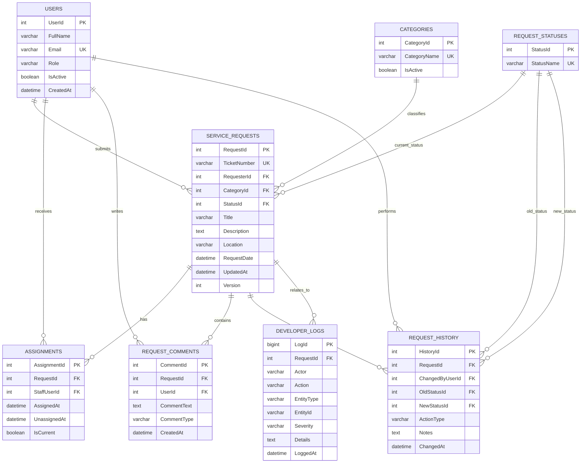

# CivicConnect Initial Database ERD

This is the editable M2 ERD source. GitHub renders the Mermaid diagram directly.

## Notes

- `ServiceRequests` stores the current state of a ticket.
- `RequestHistory` stores the business/audit history of request lifecycle changes.
- `DeveloperLogs` stores developer/application trace events such as request creation, status updates and caught persistence failures; it is not a replacement for `RequestHistory`.
- `Version` is used for optimistic concurrency so stale updates do not silently overwrite newer changes.
- The logical `Users` structure may later be adapted to the team's final authentication/identity design.
