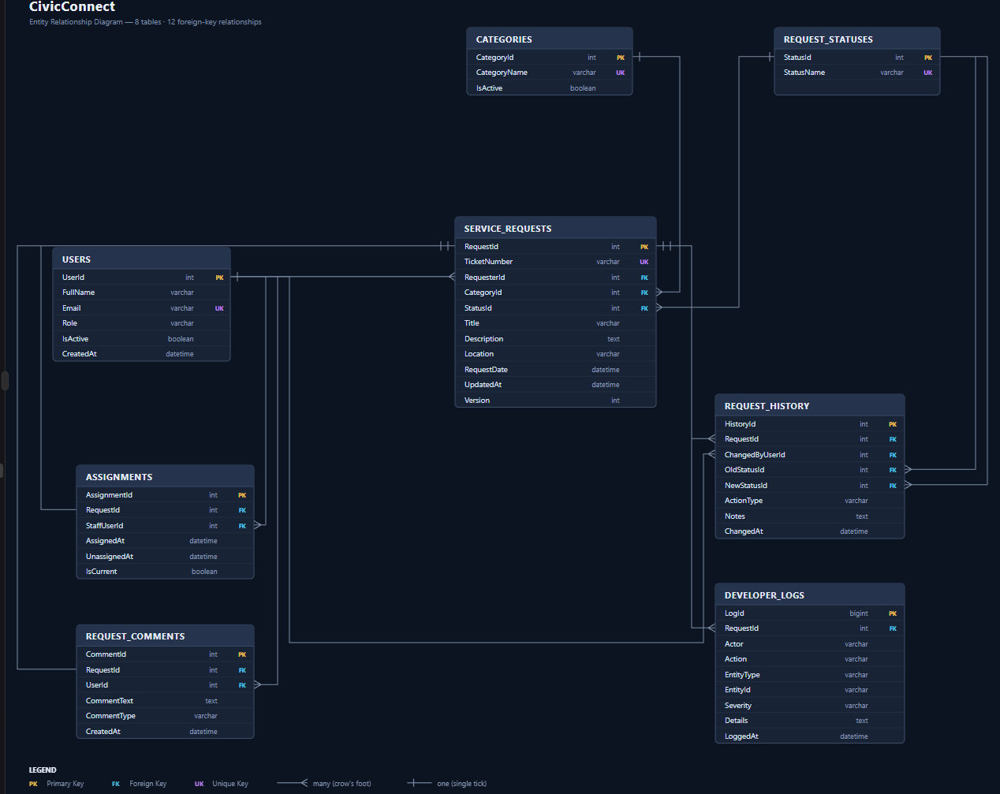

Milestone 3: Project Engineering Document (PED)

CivicConnect - Community Service Request Management Platform  
  
Agile Development Model

SEN381

Cornelius Greeff 601357 \| Aiden Moses 603067 \| Keegan Stroud 601609


## Table of Contents

- [Milestone 3 Review of the M1 and M2 Baselines](#milestone-3-review-of-the-m1-and-m2-baselines)
- [M3 Evidence Status and Document Changes](#m3-evidence-status-and-document-changes)
- [Project Overview](#project-overview)
- [Business Need](#business-need)
- [Stakeholder Analysis](#stakeholder-analysis)
- [Scope](#scope)
- [Project Constraints](#project-constraints)
- [Team](#team)
- [Schedule](#schedule)
- [Cost](#cost)
- [Quality](#quality)
- [Security](#security)
- [Interaction between Constraints](#interaction-between-constraints)
- [Functional Requirements (FR) & Acceptance Criteria](#functional-requirements-fr-acceptance-criteria)
- [Functional Requirements](#functional-requirements)
- [Non-Functional Requirements (NFR)](#non-functional-requirements-nfr)
- [Traceability Matrix (RTM) Requirements](#traceability-matrix-rtm-requirements)
- [Updated Traceability Matrix (RTM v2.0) Requirements](#updated-traceability-matrix-rtm-v20-requirements)
- [Updated Risk Register](#updated-risk-register)
- [Architecturally Significant Requirements (ASRs)](#architecturally-significant-requirements-asrs)
- [Architectural Design and Decision Records (ADRs)](#architectural-design-and-decision-records-adrs)
- [Design Patterns and Architectural Approach Used in CivicConnect](#design-patterns-and-architectural-approach-used-in-civicconnect)
- [Authentication and RBAC](#authentication-and-rbac)
- [Detailed Security & Architectural Rationale for Access Permissions](#detailed-security-architectural-rationale-for-access-permissions)
- [Data Engineering Decisions](#data-engineering-decisions)
- [Data and Persistence Engineering Baseline](#data-and-persistence-engineering-baseline)
- [Data Integrity and Validation Strategy](#data-integrity-and-validation-strategy)
- [Transaction and Rollback Strategy](#transaction-and-rollback-strategy)
- [Optimistic Concurrency Control](#optimistic-concurrency-control)
- [Request History and Developer Logging](#request-history-and-developer-logging)
- [Database Availability and Recovery Considerations](#database-availability-and-recovery-considerations)
- [Database RTM](#database-rtm)
- [ERD](#erd)
- [Forward Engineering Considerations](#forward-engineering-considerations)
- [Updated Engineering Decision Log](#updated-engineering-decision-log)
- [Team Working Agreement and Engineering Governance](#team-working-agreement-and-engineering-governance)
- [Initial Persistence Verification Table](#initial-persistence-verification-table)
- [Test Cases](#test-cases)
- [Agile Development Methodology](#agile-development-methodology)
- [AI Usage Register](#ai-usage-register)
- [Document Control/Version History](#document-controlversion-history)
- [References](#references)


# Milestone 3 Review of the M1 and M2 Baselines

The M1 business need, stakeholder groups, scope and core requirements remain the starting point. M2 added the engineering baseline: ASP.NET Core, a layered monolith, MySQL, Dapper/MySqlConnector, SQL migrations, persistence tests, request history and developer logging. M3 retains those decisions while moving from design into implementation, deployment and evidence collection.

The main M3 changes are the documented consideration of Aiven for hosted MySQL and Azure App Service for application hosting. These are separate decisions: Azure hosts the ASP.NET Core application; Aiven is the current documented candidate for managed MySQL. The database engine remains MySQL. Provider choice does not change the relational schema by itself, but the actual deployed connection and plan suitability must be verified.

**Current evidence-based position:** the staging repository contains application source, the SQL migration, test methods, a CI workflow and an Azure deployment workflow. However, source files and test methods do not prove that the complete application works. On 15 October 2026, the reported Azure homepage and `/swagger` responses were both 404, although published .NET files were present and the process was listening on port 8080. The exact deployed commit, a successful Azure API response and a successful database-backed operation have not yet been recorded here. CivicConnect remains in development and is not approved for production.

M1 and M2 content is retained as the historical and requirements baseline. M3 records changed decisions, current implementation evidence, unresolved risks and the proof still needed rather than marking unverified items as complete.

# M3 Evidence Status and Document Changes

| Area | Current evidence in repository | M3 status / next proof required |
|---|---|---|
| Schema and ERD | [Initial SQL migration](src/CivicConnect/database/migrations/001_initial_schema.sql), [database design](src/docs/database-design.md), ERD image | Schema and seed statements are version-controlled. Capture the live schema/ERD comparison and record a successful migration run. |
| Persistence and logging | `RequestRepository.cs`, `RequestService.cs`, request/history/log models and persistence tests | Implementation and tests exist. Record a real create + status update, reload saved data, verify actor/history/developer log, and save test output/date/environment. |
| Architecture | Controller, service, repository and models under `src/CivicConnect/` | Layered shape is visible in code. Confirm route behaviour, error handling, transaction/concurrency behaviour and requirement mapping through tests. |
| Database provider | Aiven is documented as the current provider choice | Do not claim deployed connectivity until the app connects successfully and a database-backed operation is verified. Keep credentials out of Git. |
| Azure release | `.github/workflows/main_civicconnect1.yml` deploys from `main`; `.github/workflows/ci.yml` tests `main` and `dev` | Reported `/` and `/swagger` returned 404 on 15 October 2026. Capture deployed SHA/workflow run, homepage response, real API response and database result after fixing. |
| Security and roles | Requirements/RBAC design and current controller routes | Authentication and role enforcement are not yet evidenced as complete. Do not claim protected production access until authorization is implemented and tested. |

**Small document-change log**

| Document | M3 change |
|---|---|
| `README.md` | Rewritten as a practical, evidence-based project entry point; explains choices, setup, routes, test prerequisites and current blockers. |
| `CivicConnect_PED_M3.md` | Corrected M1/M2 review, added evidence status, release conditions and current risks; preserved earlier requirements and design material. |
| `src/docs/adr/ADR-004_hosting_and_release.md` | Records Azure App Service, Aiven MySQL, alternatives, branch/workflow boundaries and unresolved release evidence. |
| `src/docs/adr/ADR-002_Tech_stack_and_persistence.md` and `ADR-003_data_persistence.md` | Support the relational/Dapper decision and transactional persistence approach; hosting/release choices are recorded separately in ADR-004. |

# Project Overview

CivicConnect is a web-based system designed to address the
inefficiencies in community services management due to mix communication
methods. This platform plans to improve community service requests that
are submitted and managed by the system. The current process utilized
heavily relies on multiple communication methods such as emails, phone
calls, informal messages (e.g. WhatsApp messages), spreadsheets, and
paper records.

With many different communication channels in play, requests can easily
get missed, duplicated, or assigned to the wrong person which makes it
harder for requesters to know whether their request has been sent or are
acknowledged by staff members. This is also an issue for the staff
members or management to keep track of what requests are still
outstanding. These are the core problems identified that need to be
addressed in the project. The platform we are designing aims to provide
a centralized digital workspace for submitting, processing, and
monitoring service requests.

# Business Need

At its core, CivicConnect is intended to give service requests one
central and traceable place where they can be recorded and managed from
the time they are submitted until they are completed. At the moment,
using several communication methods such as email, phone calls, WhatsApp
messages and spreadsheets makes it difficult to maintain one reliable
record of what has happened to a request. A request may be received
through one channel, discussed through another and then updated
somewhere else. This makes it harder for both the requester and staff to
know who is responsible for it and what its current status is.

Research into ticketing systems supports the need for this type of
centralised approach. Aglibar et al. (2022) explain that incidents and
requests become difficult to track manually when they form part of
everyday operations. Their study found that ticketing systems are useful
because they keep records of requests and incidents in one system and
provide tracking, monitoring and documentation. They also note that a
ticket number gives users and staff a clear reference that can be used
to find the history of a particular request. Manual tracking can also
create unnecessary work, especially where staff have to assign requests
themselves, update spreadsheets and later turn the information into
reports for management.

CivicConnect therefore aims to improve:

- visibility of submitted service requests and their current status

- accountability by showing who is responsible for a request

- communication between requesters and staff

- tracking of requests from submission to completion

- management reporting and monitoring

- control over request information and changes made to it

- the ability to look back at previous requests and their history

Similar ideas are seen in more recent help-desk research. Sari and
Tampubolon (2026) describe a help desk as a structured point of contact
that records requests, assigns responsibility, monitors progress and
provides information that can later be used to evaluate the service.
Their implemented system also made each ticket's status, responsible
person and activity history visible, which improved the traceability of
the process compared with more informal handling. This is closely
related to what CivicConnect is trying to achieve, even though
CivicConnect deals with broader community service requests rather than
only IT support.

There is also value in improving how information is collected and
managed, rather than simply replacing paper with a website. Lübeck,
Wittmann and Battistella (2021) found that electronic ticketing improved
information management and control by making information more available
and accurate while reducing some of the manual processes involved.
Although their research focused on public transport ticketing, the same
general issue is relevant to CivicConnect: bringing information into a
controlled digital process makes it easier to monitor and manage than
when records are spread across different manual channels.

The expected value of CivicConnect is therefore not simply that requests
can be entered online. The main benefit is creating a controlled history
of each request so that requesters can see progress, staff can manage
their work more clearly, and management can gain a better overview of
outstanding and completed work. At the same time, the proposed system
must remain realistic for a three-person student development team.
Features therefore need to be balanced against the available time, cost,
technical ability and the amount of development, testing and security
work that the team can reasonably complete.

# Stakeholder analysis

**Initial Stakeholders:**

| **Stakeholder**   | **Main Need**                               | **Interest** | **Influence** | **Possible Conflict**                                                              |
|-------------------|---------------------------------------------|--------------|---------------|------------------------------------------------------------------------------------|
| Requester         | Submit and track requests easily            | High         | Medium        | Wants a simple process, while security may require extra authentication/validation |
| Staff             | Manage and update assigned work efficiently | High         | High          | Detailed record keeping improves accountability but adds work                      |
| Management        | Monitor outstanding work and performance    | High         | High          | Wants detailed reporting, while project scope/time is limited                      |
| Project Team      | Deliver a secure and achievable system      | High         | High          | Additional stakeholder requests may exceed available time                          |
| Lecturer/Assessor | Evidence of controlled SE process           | High         | High          | Project cannot focus only on development at the expense of engineering evidence    |

The requester, staff and management groups are directly supported by the
minimum business capabilities given in the project brief.

# Scope

**In Scope**

The current proposed scope includes:

- user authentication

- submitting a service request

- selecting a controlled request category

- viewing submitted requests

- viewing the current status of a request

- staff access to relevant requests

- searching and filtering requests

- assigning responsibility for requests

- updating request status

- adding comments or resolution information

- resolving or closing requests

- basic management information regarding service requests

These items are based on the minimum requester, staff and management
capabilities described by the project brief.

**Out of Scope / Not Currently Planned**

The following are currently not part of the committed scope

- dedicated mobile application

- live chat system

- advanced AI functionality

- GPS/location tracking

- integration with external municipal systems

- complex predictive analytics

These may only be reconsidered later if sufficient stakeholder value and
project capacity can be demonstrated.

**Deferred Scope**

Additional features may be considered later, but they will not be added
automatically. The project brief warns that every additional feature
creates further design, implementation, testing, security and
maintenance work.

# Project Constraints

The development of CivicConnect is affected by several constraints that
influence what the team can realistically deliver. These constraints are
connected rather than independent. Decisions that increase the scope,
for example, can also increase the time, cost and testing required.
SWEBOK identifies technology, resources, finances and project duration
as factors that should be considered when determining whether a software
project is feasible, while also recognising that trade-offs between
cost, schedule and quality are a normal part of software engineering
(IEEE Computer Society, 2024).

## Team

CivicConnect is being developed by a team of three students, so the
amount of work we take on has to be manageable for a small group. Tasks
need to be shared properly so that one person does not become
responsible for a major part of the project on their own. SWEBOK points
out that software projects are strongly affected by human factors such
as teamwork, communication, coordination and the skills of the people
involved (IEEE Computer Society, 2024).

For our project, this means each member should take responsibility for
different parts of the work while still staying involved in the rest of
the project. Contributions will be shown through ClickUp tasks, commits,
Pull Requests and reviews. This is also important because every team
member needs to understand the work well enough to explain and defend it
individually during assessment.

## Schedule

CivicConnect is developed across four assessed milestones, meaning that
work cannot simply be left until the final development stage.
Requirements and project controls need to be established first so that
later design, implementation and testing have a controlled foundation.
This follows the general principle described in SWEBOK that project
phases and their deliverables provide a sequential means of maintaining
control over a project (IEEE Computer Society, 2024).

Schedule pressure also has consequences for the quality of the work
produced. Basten et al. (2021) explain that the relationship between
time pressure and software quality is complex, but previous research has
shown that developers working under pressure may work faster rather than
more efficiently and may reduce the amount of work performed to meet
deadlines. This is important for CivicConnect because meeting a
milestone should not come at the cost of necessary testing, security or
documentation. If the team falls behind, lower-priority functionality
may therefore need to be deferred rather than taking shortcuts simply to
meet the deadline.

## Cost

As a student project, CivicConnect has a limited budget and should make
use of free or low-cost development, database and hosting services where
practical. However, a service being free during development does not
necessarily mean that it is an appropriate long-term choice. Technology
decisions still need to consider free-tier restrictions, hosting and
database costs, storage limits and what continued operation would cost
outside the student environment.

Cost also cannot be considered separately from the other project
constraints. SWEBOK explains that resource requirements, including the
people and tools needed for a project, can be translated into cost
estimates, and that effort, schedule and cost estimates should be
revised as the available resources and project requirements become
clearer (IEEE Computer Society, 2024). For CivicConnect, cost will
therefore form part of later technology and deployment decisions rather
than choosing a platform only because it currently provides a free
student or trial option.

## Scope

The scope of CivicConnect must remain achievable for three students
within the available project period. The core service-request
functionality will therefore take priority over additional features that
are not necessary to address the main business need. This is important
because expanding the scope also increases the amount of design,
implementation, testing, documentation and maintenance work required.

Changes are still expected during software development, but they need to
be controlled. SWEBOK states that stakeholders should agree on how
requirements and scope will be reviewed and revised, including the use
of change-management and trade-off procedures (IEEE Computer Society,
2024). It also recommends monitoring changes in stakeholder requirements
because of their possible effect on project cost and schedule,
particularly in Agile projects where requirements can change quickly
(IEEE Computer Society, 2024).

For this reason, a new feature requested after the CivicConnect scope
has been baselined will not automatically be added. Its effect on
existing requirements, schedule, cost, security, testing and other
project artefacts will first be considered through the project's
change-control process.

## Quality

For CivicConnect, quality cannot be judged only by whether the website
appears to work during a demonstration. The project needs requirements
that can be verified and evidence showing that important functionality
behaves as expected. SWEBOK defines software quality in relation to
satisfying established requirements and stakeholder needs and identifies
inadequate reviews and testing as one of the challenges that can affect
software quality (IEEE Computer Society, 2024).

Verification, validation and testing will therefore form part of the
project rather than being treated only as final activities. SWEBOK
recommends beginning verification and validation early because
discovering defects late in development can result in rework and
increased cost. It also highlights traceability between software work
products as a way of supporting verification and validation activities
(IEEE Computer Society, 2024). For example, if CivicConnect is claimed
to enforce role-based access, the team should eventually provide test
evidence showing that permitted users can access the correct
functionality while unauthorised users are rejected.

## Security

Security needs to be considered throughout the development of
CivicConnect because the system will contain user accounts and
information associated with service requests. Relevant concerns include
authentication, role-based authorisation, protection of credentials,
input validation and preventing users from accessing information or
functionality that their role does not permit.

Khan et al. (2022) found through a systematic literature review that
treating security as an afterthought remains a problem in software
development and argue that security activities should be incorporated
throughout the SDLC. Their review identified 145 security risks and 424
practices for managing security across different development phases.
They further explain that considering security early reduces the risk of
overlooking security requirements or introducing vulnerabilities during
implementation.

This means that CivicConnect's security work cannot be postponed until
the system is complete. Security requirements and access boundaries
should influence the requirements and design, followed by appropriate
implementation practices and security testing. This is also consistent
with SWEBOK, which includes input validation, least privilege, secure
architecture and security-specific testing among recommended software
security practices (IEEE Computer Society, 2024).

## Interaction between Constraints

These constraints ultimately affect one another. A three-person team
places a limit on the amount of work that can be completed within the
fixed milestone schedule, while increasing the scope creates additional
development and verification work. Reducing the time allocated to
quality or security simply to accommodate additional features would
create a different risk rather than solving the original constraint.
SWEBOK specifically recognises trade-offs between cost, schedule and
quality as a normal part of software engineering and states that quality
activities themselves require time, resources and planning (IEEE
Computer Society, 2024).

CivicConnect will therefore prioritise its core requirements when these
constraints conflict. Lower-priority functionality can be deferred, but
essential quality and security work should not simply be removed to keep
the project on schedule. This keeps the project achievable while still
protecting the requirements that provide the main value of the system.

# Functional Requirements (FR) & Acceptance Criteria

Function requirements are the specific features and functionalities
outlining that the developed system should have. These specifications
should be able to support the qualities of the systems that connect
directly with the operations that it should perform (Trajanov, 2026).
The following functional requirements will be developed in the project:

## Functional Requirements:

**FR-001: Service Request Submission**

- Allows all registered requesters that are within the database to
  submit a service request, providing a title, description, location,
  and category.

- **Acceptance Criteria:** When an approved requester submits a valid
  request, the system generates a unique Ticket ID that is stored in
  MySQL database and provides a confirmation message to the requester.

**FR-002: Request Tracking & History**

- Requesters can view their submission history and live status updates
  if it has been acknowledged or seen by staff.

- **Acceptance Criteria:** Allows all requesters the ability to navigate
  through their submission history. The system queries MySQL database
  and creates table listing all submitted tickets with the username of
  the requester and the status (Pending, In Progress, Resolved) of the
  issue.

**FR-003: Request Assignment**

- Staff members can utilize the system to search, filter, and assign
  incoming service requests for users to themselves or designated team
  members who are qualified for that specific duty.

- **Acceptance Criteria:** Staff members that are presented with an
  unassigned request from users can select whether to assign to
  themselves or other members and the system automatically updates the
  record in MySQL database and logs the status change with a timestamp
  of when the request has been acknowledged by staff.

**FR-004: Status Transition and Resolution**

- Authorized staff members can update the progress of the request and
  record resolution notes.

- **Acceptance Criteria:** With an assigned request when staff marks it
  as "Resolved" in the database, the staff member must provide
  resolution comments or notes as well as the status of the request
  updates for all requests to view.

**FR-005: Dashboard Oversight**

- Management teams can view high-level metrics or statistics on request
  volumes, check status open or overdue, and performance of staff.

- **Acceptance Criteria:** The management dashboard executes queries on
  MySQL database to display real-time counts of open, overdue, and
  resolved requests categorized by issue type.

**FR-006: User Authentication**

- Registered users can securely log into CivicConnect before accessing
  protected system functionality.

- **Acceptance Criteria:** When a registered user enters valid login
  credentials, the system authenticates the user and grants access
  according to their assigned role. Invalid login credentials must be
  rejected.

**FR-007: Role-Based Access**

- Authenticated users can only access functionality permitted for their
  assigned role of Requester, Staff or Management.

- **Acceptance Criteria:** When a user is authenticated, Requesters can
  only access requester functionality, Staff can access authorised
  request-management functionality, and Management can access authorised
  management and oversight functionality.

**FR-008: Request Comments and History**

- Authorized users can add comments to service requests, while
  significant changes to a request are recorded in its history.

- **Acceptance Criteria:** When an authorized user adds a comment or
  performs a significant request action, the system records the relevant
  request, responsible user, action or comment and timestamp so that the
  request history can be viewed later.

**FR-009: Application Logging**

- The system records defined technical and application events to assist
  with developer troubleshooting and system traceability.

- **Acceptance Criteria:** When a defined application event occurs, the
  system records the action, affected entity, timestamp and relevant
  technical information. Sensitive information such as passwords, access
  tokens and database credentials must not be recorded.

## Non-Functional Requirements (NFR)

The non-functional criteria specify how the system should function,
addressing the important functional aspects of the system, and how it
should be executed. Having non-functional requirements ensures that the
system meets the needs of the users and stakeholders, specifically
focusing on characteristics of the system and how it should perform than
what it should do (Trajanov, 2026). For our project the following
non-functional requirements will be considered:

**NFR-001: Role-Based Access Control (RBAC)**

- The systems prioritize authorization checks based on the user's role
  (Requester, Staff, Management). This will ensure the security of the
  user data preventing access from unauthorized users (Gantayat, 2026).

**NFR-002: Performance of Page Load and Query Efficiency**

- System dashboard must be able to render web pages within 2 seconds
  under a benchmark of 50 loads concurrent to database operations. This
  specifies how fast the system should be and how fast it is able to
  respond (Gantayat, 2026).

**NFR-003: Audit Trail Logging**

- Records must be written into an audit log table with timestamps and
  user IDs including every status change, assignment, and comments or
  notes of the resolution. Ensuring the usability of the system and how
  easy user can learn how to use the system (Gantayat, 2026).

**NFR-004: Data Integrity**

- The system maintains consistent relational data and prevents
  incomplete database operations from leaving CivicConnect in an invalid
  state.

- **Acceptance Criteria:** Invalid foreign-key references and duplicate
  unique identifiers must be rejected, while defined multi-record
  database operations must either complete successfully or roll back
  without leaving partial changes.

**NFR-005: Concurrency Control**

- The system prevents outdated request information from silently
  overwriting newer changes made by another user.

- **Acceptance Criteria:** When a user attempts to update a request
  using an outdated version, the update must be rejected and the latest
  stored request information must remain unchanged.

**NFR-006: Maintainability**

- The system maintains separation between presentation, business logic
  and database-access responsibilities.

- **Acceptance Criteria:** Controllers must not contain direct SQL or
  database-access logic, and database operations must be performed
  through the defined service and repository boundaries.

# Traceability Matrix (RTM) Requirements

| Requirement ID | Business needs                                         | Architecture Component                                 | Validation Method                    | Status      |
|----------------|--------------------------------------------------------|--------------------------------------------------------|--------------------------------------|-------------|
| FR-001         | Centralized submission for requests                    | C# Web API and HTML Form                               | Integration Test and User UI Test    | M1 Baseline |
| FR-002         | Visibility status for requesters                       | C# controller and MySQL DB                             | Functional Test                      | M1 Baseline |
| FR-003         | Staff work distribution                                | C# Role-Based Access Control                           | Integration Test                     | M1 Baseline |
| FR-004         | Accountability and Auditability                        | C# Business Logic and MySQL Audit                      | Unit and Integration Test            | M1 Baseline |
| FR-005         | Service performance monitoring                         | C# Query controller                                    | UI Dashboard Verification            | M1 Baseline |
| FR-006         | Secure user authentication                             | C# Authentication / User Management Component          | Authentication and Integration Test  | Added M2    |
| FR-007         | Controlled access based on user roles                  | C# Role-Based Access Control / Authorization Component | Authorization and Role Access Test   | Added M2    |
| FR-008         | Request communication and traceable history            | C# Request Management and Audit/History Components     | Functional and Integration Test      | Added M2    |
| FR-009         | Application troubleshooting and technical traceability | C# Developer Logging Component and MySQL               | Integration and Logging Verification | Added M2    |
| FR-002.1       | Validation for Status Transition                       | C# Service Layer (RequestService.cs)                   | Unit Testing (CivicConnect.Tests)    | Added M3   | | NFR-003        | Audit Trail Logging                                    | C# Audit History Service and MySQL                     | Integration and Unit Testing         | Added M3|    | NFR-005        | Addition for protecting to avoid concurrency conflict  | C# Repository Version Check                            | Concurrency Test Suite               | Added M3    |     

| Requirement ID | Business needs                                               | Architecture Component                                     | Validation Method                               | Status      |
|----------------|--------------------------------------------------------------|------------------------------------------------------------|-------------------------------------------------|-------------|
| NFR-001        | Secure access and protection of role-specific functionality  | C# Authentication and Role-Based Access Control Components | Authentication, Authorization and Security Test | M1 Baseline |
| NFR-002        | Responsive system performance under expected user load       | C# Web Application, Business Logic and MySQL               | Performance and Load Test                       | M1 Baseline |
| NFR-003        | Accountability and traceability of request lifecycle changes | C# Audit/History Component and MySQL                       | Audit Trail and Integration Test                | M1 Baseline |
| NFR-004        | Reliable and consistent application data                     | C# Service/Repository Layer and MySQL                      | Constraint, Transaction and Rollback Test       | Added M2    |
| NFR-005        | Protection against conflicting or outdated request updates   | C# Request Service/Repository and MySQL                    | Concurrency Conflict Test                       | Added M2    |
| NFR-006        | Maintainable separation of application responsibilities      | Controllers, Services and Repository Layer                 | Architecture Review and Unit Test               | Added M2    |

# Updated Traceability Matrix (RTM v2.0) Requirements

<table>
<colgroup>
<col style="width: 7%" />
<col style="width: 9%" />
<col style="width: 7%" />
<col style="width: 8%" />
<col style="width: 14%" />
<col style="width: 17%" />
<col style="width: 9%" />
<col style="width: 15%" />
<col style="width: 10%" />
</colgroup>
<thead>
<tr class="header">
<th>ID</th>
<th>Requirement needs</th>
<th>ASR Link</th>
<th>Architecture Module</th>
<th>Data Impact</th>
<th>Design</th>
<th>Tech Choice</th>
<th>Evidence</th>
<th>Status</th>
</tr>
</thead>
<tbody>
<tr class="odd">
<td>FR-001</td>
<td>Submission of user Requests</td>
<td>ASR-02, ASR-03</td>
<td>Core API / Request Slice</td>
<td>Inserts record into service_requests table</td>
<td>IRequestService.RequestSubmission(), RequestController.Create()</td>
<td>C# .NET 9, Dapper, MySQL</td>
<td>Controllers/RequestController.cs</td>
<td>Implemented</td>
</tr>
<tr class="even">
<td>FR-001.1</td>
<td>Submission Validation Enforcement</td>
<td>ASR-03</td>
<td>Service Layer</td>
<td>None</td>
<td>Validation check for username and Request Description</td>
<td>C# .NET 9</td>
<td>Services/RequestService.cs</td>
<td>Implemented</td>
</tr>
<tr class="odd">
<td>FR-002</td>
<td>Request Tracking and Status Query</td>
<td>ASR-01, ASR-02</td>
<td>Core API / Request Slice</td>
<td>Queries service_requests table</td>
<td>IRequestService.GetRequestByIdAsync(),
RequestController.GetById()</td>
<td>C# .NET 9, Dapper, MySQL</td>
<td><p>Controllers/RequestController.cs</p>
<p>Services/RequestService.cs</p>
<p>Data/RequestRepository.cs</p></td>
<td>Implemented</td>
</tr>
<tr class="even">
<td>FR-002.1</td>
<td>Status Transition Validation</td>
<td>ASR-03</td>
<td>Service Layer</td>
<td>Updates status column in service_requests</td>
<td>IRequestService.UpdateRequestStatus()</td>
<td>C# .NET 9</td>
<td>Services/RequestService.cs</td>
<td>Implemented</td>
</tr>
</tbody>
</table>

# Updated Risk Register

<table>
<colgroup>
<col style="width: 16%" />
<col style="width: 16%" />
<col style="width: 16%" />
<col style="width: 16%" />
<col style="width: 16%" />
<col style="width: 16%" />
</colgroup>
<thead>
<tr class="header">
<th>Risk</th>
<th>Description</th>
<th>Probability</th>
<th>Impact</th>
<th>Priority</th>
<th><p>Mitigation</p>
<p>Strategy</p></th>
</tr>
</thead>
<tbody>
<tr class="odd">
<td>1</td>
<td>Connection issues with MySQL database or issues in deployment with
schema</td>
<td>Medium</td>
<td>High</td>
<td>High</td>
<td>Use version-controlled numbered SQL migration scripts and verify
schema versions across development environments.</td>
</tr>
<tr class="even">
<td>2</td>
<td>Scheduling issues during Agile sprint iterations</td>
<td>High</td>
<td>Medium</td>
<td>High</td>
<td>Track tasks weekly with ClickUp or discord server and use strict
commits to core scope only.</td>
</tr>
<tr class="odd">
<td>3</td>
<td>Unintentional exposure of sensitive data in GitHub repo</td>
<td>Low</td>
<td>High</td>
<td>Medium</td>
<td>Add .gitignore to protect sensitive information</td>
</tr>
<tr class="even">
<td>4</td>
<td>Exposing the database connection strings, user credentials, or
sensitive data within public GitHub commits</td>
<td>Low</td>
<td>High</td>
<td>High</td>
<td>Enforcing the .gitignore rules for the local configuration of files,
utilize the environment variables, and mandatory peer PR reviews from
team members before merging into main</td>
</tr>
<tr class="odd">
<td>5</td>
<td>Enforce Tight coupling between ASP.NET Core controllers and MySQL
database to prevent unit testing.</td>
<td>Medium</td>
<td>High</td>
<td>High</td>
<td>Implement a Repository and Domain Service patterns which utilize the
Dependency Injection allowing xUnit for mocking without the need for a
live database connection.</td>
</tr>
<tr class="even">
<td>6</td>
<td>Uncontrolled status transitions in the user request essentially
directly transforming a service request from "Pending" to "Resolved"
without a description of staff notes</td>
<td>Medium</td>
<td>Medium</td>
<td>Medium</td>
<td>Implement a validation logic inside the domain service layer to
reject any invalid status transitions prior to the database
persistence.</td>
</tr>
<tr class="odd">
<td>7</td>
<td>Concerns regarding the Web API query slowdowns or dashboard timeout
when retrieving large volumes of service request logs.</td>
<td>Low</td>
<td>High</td>
<td>Medium</td>
<td>Incorporate the addition of a database indexes on the frequently
queried columns and write optimized, parameterized Dapper queries</td>
</tr>
<tr class="even">
<td>8</td>
<td>Deadlines due to scope creep or workload distribution within the
3-person development team.</td>
<td>High</td>
<td>Medium</td>
<td>High</td>
<td>Enforce the baseline scope boundaries, perform regular reviews with
sprint task assignments weekly, and defer any lower-priority or
non-essential features for the system</td>
</tr>
<tr class="odd">
<td>9</td>
<td>Migration for the database schema mismatch errors in the local
development environments and target database server instances</td>
<td>Medium</td>
<td>High</td>
<td>High</td>
<td>Maintain the version-control for the SQL migration scripts or
migration in the repository and perform mandatory schema verification
checks before deployment.</td>
</tr>
<tr class="even">
<td>10</td>
<td>Unrestricted privileges or permissions in escalation where
requesters can access staff or management of administrative
endpoints.</td>
<td>Low</td>
<td>High</td>
<td>High</td>
<td>Enforce Role-Based Access Control (RBAC) across all the API
endpoints utilizing ASP.NET Core attributes and token claims to check
the validation</td>
</tr>
</tbody>
</table>

### M3 risk review (supplement to the M1/M2 register)

The risks below add current deployment and evidence concerns to the existing register; they do not silently replace the earlier entries. Probability and priority are provisional team assessments and should be reviewed at the next team check-in.

| ID | M3 risk / evidence | Probability | Impact | Priority | Mitigation and closure evidence |
|---|---|---|---|---|---|
| M3-R01 | Azure deployment returns 404 for `/` and `/swagger` in the latest reported check. | High until retested | High | High | Record deployed SHA/run; inspect startup and route logs; verify homepage, `/health` and a real API route after redeploy. |
| M3-R02 | Deployed app may not connect to the intended MySQL provider/database. | Medium | High | High | Confirm the connection setting is supplied as a secret; verify TLS/network access and run a create/read/status-update operation with related history/log rows. Never record secret values. |
| M3-R03 | CI does not trigger on pushes to `staging`; Azure deploy workflow targets `main`. | High for staging-only changes | High | High | Run checks deliberately or update workflow triggers through a reviewed change; record the exact tested/deployed commit and workflow run. |
| M3-R04 | Test methods exist, but successful results and environment evidence are not yet captured for the full suite. | Medium | High | High | Run unit, API integration and database-backed tests; save pass/fail/skip counts, date, environment and workflow/run link. |
| M3-R05 | Authentication/RBAC and staff/management features are not yet verified as complete. | Medium | High | High | Implement and test role restrictions and negative access cases before exposing write operations as production-ready. |
| M3-R06 | Backup, restore, availability, plan limits and total hosted-service cost remain unverified. | Medium | High | High | Check current Aiven/Azure plans and cost; document backup/restore ownership and perform a restore rehearsal before production approval. |
| M3-R07 | Local Docker Compose includes fixed development credentials. | Medium | Medium | Medium | Restrict to disposable local use; replace hard-coded credentials with environment-supplied values before shared/staging use and never reuse them in hosted environments. |


# Architecturally Significant Requirements (ASRs)

**ASR-01: Performance and Response Latency:**

- Execution of the system of the single-entity should fetch operations
  for the Web API with an end-to-end server response of \<200ms latency
  under normal operational load.

**ASR-02: Security and SQL Injection Prevention:**

- All database operations within the Data Access Layer of the system
  should strictly execute parameterized queries through the
  MySqlConnection to neutralize any vulnerabilities that involve SQL
  injection.

**ASR-03: Maintainability and Testability:**

- System is highly decoupling between the business constraints, web
  controllers, and database access which must be able to be maintained
  using Dependency Injection and involve strict interface boundaries for
  the IRequestService and IRequestRepository which would enable unit
  testing to isolate it from any external infrastructure.

# Architectural Design and Decision Records (ADRs)

**ADR-001: Architectural Style Selection**

- **Context:** CivicConnect system requires a structured backend which
  would separate the HTTP routing, core business constraints, and any
  database queries.

- **Decision:** Adopt a 3-Tier Layered Architecture.

- **Rationale:** Isolates presentation, domain logic, and data
  persistence layers into clear boundaries which would further enable
  unit testing of business rules without the need of requiring live
  database connection.

**ADR-002: Technology Stack and Data Access**

- **Context:** CivicConnect system requires reliable requests from the
  requesters which would involve the incorporation of High execution
  speeds, strong typing, and direct control over SQL queries.

- **Decision:** Integrated C# language (.NET 9 Web API) into the system
  paired with MySQL database.

- **Rationale:** For the high execution speeds integrating Dapper for
  the native ADO.NET will ensure the system speeds while eliminating any
  object-relational mapping overhead and enforcing parameterized SQL
  execution.

**ADR-003: Design Pattern - Repository Pattern**

- **Context:** CivicConnect system testability will be hampered due to
  any direct database access inside controllers and tightly couples
  presentation to infrastructure.

- **Decision:** Interface-backed Repository Pattern.

- **Rationale:** It will encapsulate database query logic separating it
  from the business services, facilitating unit test mocking through
  xUnit.

**ADR-004: Design Pattern - Dependency Injection**

- **Context:** Management of the concrete dependencies of the objects
  will generally create tight coupling and lifecycle issues.

- **Decision:** Integrate the built-in ASP.NET Core Service Container.

- **Rationale:** Should be able to manage the object lifecycles cleanly
  and decouples service implementations from the concrete controllers.

# Design Patterns and Architectural Approach Used in CivicConnect

## What design patterns mean in this project

A design pattern is a commonly used way of solving a software design problem. It is not a feature on its own, and it does not mean copying a ready-made piece of code. A pattern describes how parts of an application can be organised so that the code is easier to understand, test, change and maintain.

CivicConnect uses a few related design approaches to keep the web API, business rules and database work separate. This is useful for our project because the system needs to manage requests and their status changes while keeping the request information, history and developer logs consistent. It also allows the team to work on different parts of the application without putting all the logic into one large controller or one database class.

The main approaches discussed in this section are the Repository Pattern, Dependency Injection, and the layered architecture used to connect the application components. The first two are commonly described as design patterns or design techniques. Layered architecture is more accurately described as an architectural style. They are related, but they are not exactly the same thing.

## Repository Pattern

The Repository Pattern separates database access from the rest of the application. Instead of a controller writing SQL directly, it calls a service, and the service uses a repository to read or save data. The repository is responsible for database queries and persistence-related work.

CivicConnect uses this approach for request data. For example, `RequestRepository.cs` contains the database operations for service requests, while `RequestService.cs` contains the request validation and workflow rules. The repository works with MySQL through Dapper and MySqlConnector. The code also defines repository interfaces, such as `IRequestRepository`, so that the service can depend on an interface rather than needing to know every detail of the database implementation.

This separation is helpful because database code and business rules have different responsibilities. If a query needs to change, the work can usually be made in the repository without moving SQL into the controller. It also makes the business logic easier to test separately. Where a test uses a substitute implementation of a repository, it can focus on the service's behaviour without needing a live database for every test.

The pattern does not automatically guarantee that the database is correct or that every test is isolated. Those results still depend on the queries, transaction handling, validation and tests that the team writes. For this reason, database-backed tests are still needed to verify real persistence behaviour.

**CivicConnect evidence:**
- `src/CivicConnect/Data/RequestRepository.cs` — request persistence and SQL operations.
- `src/CivicConnect/Services/RequestService.cs` — request validation and workflow rules.
- `src/CivicConnect/Core/Data/IRequestRepository.cs` or the corresponding repository interface file — repository contract, depending on the current project folder structure.
- `src/CivicConnect/Controllers/RequestController.cs` — HTTP endpoints that call the service instead of containing the request SQL themselves.

## Dependency Injection

Dependency Injection (DI) means that a class receives the services or objects it needs instead of creating all those dependencies itself. In CivicConnect, ASP.NET Core's built-in service container is used to register the service and repository implementations and provide them where they are needed.

For example, `Program.cs` registers `IRequestService` with `RequestService` and registers the request repository implementation. The application can then provide the required service to a controller. This keeps the controller from having to construct its own service and database repository.

DI works well with interfaces because code can depend on a contract rather than being tied directly to one concrete class. It also gives the application a central place to configure how objects are created and how long they are kept. CivicConnect registers its request and user services as scoped services, which suits dependencies used during an individual web request.

The main benefit is reduced coupling. It is easier to replace an implementation or supply a test double when the dependency is provided through the application's service container. DI does not itself provide security, validation or correct business behaviour; those still need to be implemented and tested.

**CivicConnect evidence:**
- `src/CivicConnect/Program.cs` — service and repository registrations.
- `src/CivicConnect/Services/RequestService.cs` — service implementation used by the application.
- `src/CivicConnect/Controllers/RequestController.cs` — API controller that uses the request service.

## Layered architecture

CivicConnect follows a layered structure that separates the application's responsibilities. In the current backend, the main flow is:

```text
HTTP request
    |
    v
RequestController
    |
    v
RequestService
    |
    v
IRequestRepository / RequestRepository
    |
    v
Dapper + MySqlConnector
    |
    v
MySQL database
```

The controller handles the HTTP side of the feature, such as receiving a request and returning an appropriate response. The service applies the rules that determine whether the operation is valid. The repository performs the database work. Dapper and MySqlConnector provide the data-access connection to MySQL.

This structure makes the code easier to follow because each part has a clear main responsibility. It also helps testing: controller behaviour, service rules and database operations can be tested at different levels. It is not a strict guarantee that every class is perfectly separated, so the team should continue to check that controllers do not accumulate business rules and that repositories do not become responsible for HTTP behaviour.

Layered architecture is an architectural style rather than a classic object-level design pattern. It is included here because it is the overall structure that allows the Repository Pattern and Dependency Injection to work together in CivicConnect.

**CivicConnect evidence:**
- `src/CivicConnect/Controllers/` — HTTP API layer.
- `src/CivicConnect/Services/` — business and workflow rules.
- `src/CivicConnect/Data/` — data-access implementation.
- `src/CivicConnect/Program.cs` — application setup and dependency registration.

## Example: creating a service request

The request creation flow shows how these approaches work together. A client sends a request to the API. The controller receives it and passes it to the service. The service checks the required values and applies the request rules. The repository then writes the request and its related records to MySQL.

In the current request repository implementation, request creation uses a database transaction for the request, request-history entry and developer log. The operation commits when it succeeds and attempts to roll back if an exception occurs. This helps prevent a failed creation from leaving only some of those related records saved. The implementation still needs suitable failure-path integration tests to demonstrate that rollback behaves correctly against the configured database.

The flow can be summarised as follows:

- **Controller:** accepts the HTTP request and returns the HTTP response.
- **Service:** checks the request data and applies workflow rules.
- **Repository:** runs parameterized SQL and coordinates the persistence transaction.
- **Database:** stores the request and related records.

This is a practical example of why the code is split into layers. Each part has a focused responsibility, and the full operation can still be tested from the API down to the database.

## Why these approaches were selected

The team chose these approaches because CivicConnect is a relatively small application being developed by a small team, but it still needs clear boundaries between the web API, business rules and database. A layered monolith keeps deployment and operation straightforward while giving the code enough structure to be maintained and tested.

The Repository Pattern keeps SQL out of the controllers and services. Dependency Injection reduces the need for classes to construct their own dependencies. The layered architecture gives the application an understandable flow from HTTP request to stored data. Together, these choices support maintainability and testability without introducing the extra deployment and coordination overhead of separate services.

There are trade-offs. Additional interfaces and layers mean more files and some extra setup, and the team must maintain the boundaries rather than allowing responsibilities to drift between layers. For the current project size and scope, this is a reasonable balance.

## Verification and limitations

The implementation can be inspected in the source files listed above, and the existing test project provides a place to verify expected behaviour. However, the presence of a pattern in the source code is not by itself proof that all related behaviour works correctly.

The team should retain test results showing that request validation works, database operations persist the expected records, failures do not leave partial data, and concurrent status updates are handled safely. Unit tests can focus on service rules, while integration tests should exercise the real database and transaction behaviour. Test claims in the PED should match the actual test output and should not be marked complete merely because a test method exists.

These patterns also do not mean that all production-readiness requirements have been completed. In particular, authentication and server-side role-based authorization must be verified separately. Dependency Injection and the Repository Pattern improve code organisation; they do not replace access controls, secure configuration, database TLS verification, backups or release testing.

General Assumptions and Dependencies

| **ID** | **Assumption / Dependency**                                                                                  | **Current Position in M2**                                                            | **Engineering Consequence if Changed**                                                                                                                                    |
|--------|--------------------------------------------------------------------------------------------------------------|---------------------------------------------------------------------------------------|---------------------------------------------------------------------------------------------------------------------------------------------------------------------------|
| AD-001 | MySQL will remain the relational database technology for CivicConnect.                                       | Retained from the M1 baseline and currently used by the persistence design.           | A database technology change would affect the schema, SQL migrations, Dapper repository implementation, deployment configuration and database verification evidence.      |
| AD-002 | C# and ASP.NET Core will remain the primary backend/application environment.                                 | Retained from M1 and reflected in the current project implementation.                 | Changing the backend technology would affect controllers, services, dependency injection, testing, interfaces and deployment decisions.                                   |
| AD-003 | Dapper and MySqlConnector will remain compatible with the selected .NET runtime.                             | Current M2 persistence dependency.                                                    | Package or runtime incompatibility may require dependency upgrades, code changes or a controlled persistence decision change.                                             |
| AD-004 | The initial controlled request statuses are Pending, In Progress and Resolved.                               | Used by the current schema and request workflow.                                      | Additional or changed statuses would affect validation logic, seed data, workflow rules, tests and possibly the RTM.                                                      |
| AD-005 | The initial request categories are suitable for development and early verification.                          | Current development seed values; not treated as an unchangeable stakeholder baseline. | Category changes may require migration/seed updates but should not require architectural redesign.                                                                        |
| AD-006 | The logical Users data model will be aligned with the final authentication and RBAC implementation.          | Authentication implementation is still being developed.                               | If the chosen authentication framework manages identity differently, the current user schema may need to be mapped or adapted to prevent duplicated identity information. |
| AD-007 | A MySQL instance will be available to team members for development and verification.                         | Required for persistence integration testing.                                         | Database unavailability would block migration verification and database-backed integration testing but should not prevent isolated service-layer development.             |
| AD-008 | The current documented hosted database choice is Aiven for MySQL; production suitability is not yet confirmed. | M3 provider choice for development/integration; successful deployed connectivity remains unverified. | Confirm TLS/network access, plan limits, cost, backup/restore and a successful database-backed operation before any production claim. |
| AD-009 | Production backup, retention and recovery requirements are not yet finalised.                                | Forward engineering consideration.                                                    | The final deployment baseline must define backup frequency, retention, restore procedures, recovery ownership and acceptable recovery objectives.                         |
| AD-010 | DeveloperLogs currently represents technical/application trace logging requested for engineering visibility. | Current interpretation used in the persistence design.                                | If lecturer clarification changes the intended meaning, the logging model and related documentation must be updated through controlled change.                            |

# Authentication and RBAC

| **System Function / Action**          | **Requester**     | **Staff**            | **Management**       |
|---------------------------------------|-------------------|----------------------|----------------------|
| Submit New Service Request            | **Allowed (Yes)** | Team Policy Decision | Team Policy Decision |
| View Own Submitted Requests           | **Allowed (Yes)** | **Allowed (Yes)**    | **Allowed (Yes)**    |
| View Staff Work Queue & Search        | Denied (No)       | **Allowed (Yes)**    | **Allowed (Yes)**    |
| Assign Ticket / Update Status         | Denied (No)       | **Allowed (Yes)**    | Policy Decision      |
| Access Management Oversight Dashboard | Denied (No)       | Denied (No)          | **Allowed (Yes)**    |

## Detailed Security & Architectural Rationale for Access Permissions

**1. Submit New Service Request:  
• Requester (Allowed):** The core self-service capability of the
CivicConnect platform. Any authenticated citizen/requester must be
capable of logging municipal issues (e.g., water leaks, damaged
infrastructure). Staff and Management submissions are marked 'Team
Policy Decision' depending on whether municipal agents log tickets
directly on behalf of walk-in/call-in citizens.

**2. View Own Submitted Requests:  
• Requester / Staff / Management (Allowed):** Ensures user feedback
loops and status transparency. Every role is permitted to track issues
they personally initiated. Service-layer authorization enforces
row-level data access control filtering by \`RequesterUserId ==
CurrentUserId\` so users cannot view other citizens' submitted tickets.

**3. View Staff Work Queue & Search:  
• Requester (Denied):  
• Staff & Management (Allowed):** Public requesters are denied access to
prevent unauthorized exposure of municipal operational queues,
unassigned internal workloads, and sensitive community ticket metadata
(Principle of Least Privilege). Staff and Management are allowed access
as browsing, searching, and filtering tickets is their primary daily
operational workflow.

**4. Assign Ticket / Update Status:  
• Requester (Denied):  
• Staff (Allowed):** Requesters cannot reassign tickets or change state
transitions (e.g., moving a ticket directly to 'Resolved'), preventing
state corruption and fraud. Staff members are allowed as ticket
lifecycle progression is their core duty. Management access is governed
by team policy (whether managers act as active ticket processors or
strictly monitor queues).

**5. Access Management Oversight Dashboard:  
• Requester & Staff (Denied):  
• Management (Allowed):** Requesters and operational Staff are
restricted from strategic executive data (Separation of Duties).
Management requires exclusive access to aggregate SLA metrics, category
volume trends, bottleneck analysis, and high-level municipal performance
reports.

# Data Engineering Decisions

## Data and Persistence Engineering Baseline

CivicConnect uses MySQL as its relational persistence technology,
continuing the database technology established during Milestone 1.
During Milestone 2, the persistence implementation was further defined
as **Dapper with MySqlConnector** within the ASP.NET Core application.
Dapper was selected because the current application already uses a
repository-based explicit SQL approach, and replacing this with another
persistence technology during the milestone would introduce unnecessary
migration and integration work.

The persistence architecture follows the application structure:

**Controller → Service → Repository → Dapper/MySqlConnector → MySQL**

Responsibilities are intentionally separated between these layers.
Controllers handle application requests, while the service layer manages
business rules and workflow validation. Repository classes contain the
parameterised SQL required to access MySQL. Database access must
therefore not be introduced directly into controllers or presentation
components.

The current relational model consists of Users, Categories,
RequestStatuses, ServiceRequests, Assignments, RequestComments,
RequestHistory and DeveloperLogs. ServiceRequests represents the current
state of a service ticket, while supporting entities preserve
classifications, responsibility, comments and historical information.
The model supports the requirements established in M1, including request
submission, tracking, assignment, status transitions, auditability and
management reporting. The current repository database-design artefact
explicitly maps these entities to FR-001 to FR-005.

Logical ownership is also used to reduce unnecessary coupling. Request
Management owns the main request lifecycle, categories and assignment
information. Audit/History owns the lifecycle history, while
application/developer logging is responsible for technical trace
information. Although the data currently resides in one MySQL database,
logical ownership prevents components from bypassing their intended
service and repository.

## Data Integrity and Validation Strategy

CivicConnect uses a multi-tier validation strategy rather than relying
on a single layer to protect application data.

The presentation layer is responsible for basic input formatting and
user feedback. The application/service layer enforces business rules
such as required request information, valid workflow operations and
resolution-note requirements. MySQL provides the final structural
safeguards through primary keys, foreign keys, NOT NULL constraints and
UNIQUE constraints.

This approach allows business rules to remain maintainable and testable
within the application while ensuring that invalid relational data
cannot be persisted if an application-level validation path is bypassed.
The Assignment 2 persistence investigation similarly identified
presentation, application and database validation as separate
responsibilities and recommended application-managed business rules
together with MySQL structural safeguards. Assignment 2

Important database integrity controls include unique user email
addresses and ticket numbers, controlled category and request-status
values, and foreign-key relationships between requests, requesters,
categories, statuses, assignments and history records.

## Transaction and Rollback Strategy

Operations that change more than one related record are treated as a
single logical transaction. This prevents CivicConnect from leaving the
database in a partially completed state.

For example, creating a service request currently requires the system to
create the ServiceRequests record, obtain the new request identifier,
create the initial RequestHistory entry and record the relevant
DeveloperLogs entry. These operations are executed within one
transaction. If a required database operation fails, the transaction is
rolled back rather than committing only part of the operation.

Status changes follow the same principle. The existing request state is
checked, the status is changed, the concurrency version is updated and
the corresponding history and developer-log records are created before
the transaction is committed.

This decision follows the Assignment 2 recommendation that application
services should manage transactional boundaries while MySQL provides
relational safeguards. The research specifically identified rollback as
necessary for multi-step entity writes where partial completion would
create inconsistent application data. Assignment 2

**Engineering consequence:** transaction handling increases
implementation complexity slightly, but it reduces the more serious risk
of a request changing without the corresponding history or technical
trace being stored.

## Optimistic Concurrency Control

CivicConnect uses an integer Version field on ServiceRequests as an
optimistic concurrency token. The purpose is to prevent a user from
silently overwriting a newer change made by another user.

When a request is read, its current version is supplied with a later
update. The repository compares the expected version with the database
version before applying the change. A successful update increments the
version. If the stored version has already changed, the incoming
operation is treated as stale and is rejected rather than overwriting
the newer state.

For example, if two staff members both read version 3 of the same
request and the first update changes the stored version to 4, the second
update using expected version 3 should be rejected.

Assignment 2 identified a row-version or timestamp mechanism as an
appropriate way for the C# application to detect conflicting updates and
reduce the risk of lost updates during simultaneous operations.

## Request History and Developer Logging

CivicConnect separates business/audit history from technical application
logging because the two records serve different purposes.

RequestHistory stores important events in the service-request lifecycle.
These records may include the affected request, responsible user,
previous and new status, action type, timestamp and relevant notes. This
supports FR-002, FR-003, FR-004 and NFR-003 by preserving a traceable
record of significant changes.

DeveloperLogs stores selected application and engineering trace events.
Examples include successful request creation, status updates, controlled
administrative activity and persistence failures handled at an
application boundary. These logs are intended to support troubleshooting
and technical traceability rather than replacing the request audit
trail.

Developer logs must not contain passwords, access tokens, connection
strings or other sensitive credentials. Logging every user interaction
is also unnecessary and could introduce excessive storage and privacy
risk.

The separation prevents technical diagnostic information from being
confused with the official business history of a service request.

## Database Availability and Recovery Considerations

The current CivicConnect design relies on a single logical MySQL
database. This makes the persistence layer a potential single point of
failure because the application cannot safely create or update requests
while the database is unavailable.

Milestone 2 records this as an engineering risk rather than introducing
unnecessary high-availability infrastructure before the deployment
environment has been finalised. The application should fail safely when
database connectivity is unavailable and must not report a data-changing
operation as successful unless the required transaction was committed.

Before production deployment, the team still needs to determine the
final hosting arrangement, backup frequency, backup retention, restore
process, recovery ownership and acceptable recovery objectives. These
remain Forward Engineering Considerations rather than completed M2
infrastructure.

This is directly relevant because the M2 marking criterion specifically
asks for data/persistence evidence covering integrity, consistency and
relevant scalability, availability and SPOF implications.

## Database RTM

| **Req** | **Data / persistence impact**                                                                   | **Tech evidence**                                          | **Implementation evidence**                                                        | **Verification**               | **Status**               |
|---------|-------------------------------------------------------------------------------------------------|------------------------------------------------------------|------------------------------------------------------------------------------------|--------------------------------|--------------------------|
| FR-001  | Users, Categories, RequestStatuses, ServiceRequests; unique TicketNumber; transaction integrity | Repository boundary, Dapper + MySQL, ADR-002/003           | ServiceRequest.cs, RequestService.cs, RequestRepository.cs, 001_initial_schema.sql | Planned / Not Yet Verified     | In Development           |
| FR-002  | Current state in ServiceRequests; historical state in RequestHistory                            | Request/history separation                                 | repository retrieval queries + schema                                              | Planned                        | In Development           |
| FR-003  | Assignments, staff FK, timestamps and history requirement                                       | Relational assignment model                                | Schema exists; application assignment implementation still required                | Planned                        | In Development / Planned |
| FR-004  | Status FK, RequestComments, RequestHistory, transaction and Version                             | Service validation + transactional status update           | UpdateRequestStatus, status history/log persistence                                | Planned                        | In Development           |
| FR-005  | Indexed request/status/category/assignment data                                                 | MySQL query/index strategy                                 | Database schema/indexes available; dashboard implementation still required         | Planned                        | Planned                  |
| NFR-001 | User/role context in persistence model                                                          | Must integrate with final Auth/RBAC                        | Logical Users model exists; auth implementation separate                           | Planned                        | Planned / In Development |
| NFR-002 | Indexing/query-efficiency considerations                                                        | Initial indexes only; final optimisation after measurement | Initial schema indexes                                                             | Performance verification later | Planned                  |
| NFR-003 | RequestHistory + responsible user/timestamps/status/actions                                     | Audit/history separation and transactional writes          | Request history writes implemented for current request create/status paths         | Planned                        | In Development           |

#  

## ERD

# Forward Engineering Considerations

| **Lifecycle consideration**                          | **Why it requires attention**                                                                                                                                                                                                                                                                                                                                                                           | **Supporting academic evidence**                                                                                                                                                              |
|------------------------------------------------------|---------------------------------------------------------------------------------------------------------------------------------------------------------------------------------------------------------------------------------------------------------------------------------------------------------------------------------------------------------------------------------------------------------|-----------------------------------------------------------------------------------------------------------------------------------------------------------------------------------------------|
| 1\. Security and secure development                  | CivicConnect will manage user accounts and service-request data so authentication, authorisation, input validation and information protection need to be built in during development and testing than bolted on at the end. Khan et al. (2022) Found that security should be incorporated throughout the software development lifecycle and that treating it as an afterthought leaves risks unmanaged. | Khan et al. (2022) found that security should be incorporated throughout the software development lifecycle, and that treating it as an afterthought leaves important risks unmanaged.        |
| 2\. Architectural maintainability and technical debt | Future architecture and implementation choices should be reviewed for their long-term impact                                                                                                                                                                                                                                                                                                            | Soliman, Avgeriou and Li (2021) found that architectural design decisions can deliberately or inadvertently create technical debt, and that such decisions can be difficult to reverse later. |
| 3\. Scope and requirement volatility                 | Stakeholder requirements are likely to shift as development continues. New requests should be weighed against their effect on scope, timeline, quality and effort before being accepted.                                                                                                                                                                                                                | Mohammad and Kollamana (2024) identified requirement volatility as a major issue in Agile projects and examined practices that help teams manage changing requirements.                       |
| 4\. Agile process and continuous improvement         | The team should keep checking whether our actual working practices support effective iterative development, rather than assuming that calling the process “Agile” automatically makes it Agile.                                                                                                                                                                                                         | Kuhrmann et al. (2022) found that the practices a team actually uses, and the project context, are what shape the degree of agility achieved — not the label attached to the process.         |
| 5\. Database and system evolution                    | The database and system architecture need to stay maintainable as functionality grows. Future changes should be planned for carefully so that short-term implementation choices do not make later changes unnecessarily difficult.                                                                                                                                                                      | Pérez et al. (2021) found that a well-defined architecture, design, scope and set of requirements are among the practices software teams use to prevent or reduce technical debt.             |

The lifecycle concerns below are ones we intend to keep revisiting as
CivicConnect moves past this milestone. They are forward-looking issues
to watch, not finished engineering decisions, and each one should be
reassessed as we gather more requirements, implementation evidence,
testing results and stakeholder feedback.

# Updated Engineering Decision Log

| **ID** | **Engineering decision**                                                                                                                          | **Decision rationale**                                                                                                                                                                                                                                                   | **Status**   |
|--------|---------------------------------------------------------------------------------------------------------------------------------------------------|--------------------------------------------------------------------------------------------------------------------------------------------------------------------------------------------------------------------------------------------------------------------------|--------------|
| ED-001 | Use a web-based platform as the primary CivicConnect system.                                                                                      | A centralised web platform supports the overall goal of managing service requests through one controlled system, and it sets the foundation for the rest of the application design.                                                                                      | Decided – M1 |
| ED-002 | Use C# as the primary application programming language.                                                                                           | C# is the technology selected for the system’s planned API, controllers and business logic. This decision gives the team a consistent implementation direction for the milestone.                                                                                        | Decided – M1 |
| ED-003 | Use MySQL for persistent application data.                                                                                                        | MySQL has been selected as the relational database technology for storing application data such as service requests, statuses, assignments and audit information.                                                                                                        | Decided – M1 |
| ED-004 | Use an Agile development approach.                                                                                                                | The project will run on iterative development, sprint-based work, backlog management and regular review. Kuhrmann et al. (2022) show that it is the practices actually used within a project, not the label given to the process, that determine how Agile it really is. | Decided – M1 |
| ED-005 | Use controlled version-control practices for development changes.                                                                                 | Changes need to be checked before they are added. The team makes sure there is a clear record of what changed and makes sure there is less chance of code that hasn't been looked at getting into the main code                                                          | Decided – M1 |
| ED-006 | Use a central backlog and task-management process.                                                                                                | A centralised backlog gives the team a consistent way to assign work, track progress and connect development activity back to project requirements.                                                                                                                      | Decided – M1 |
| ED-007 | Use Dapper and MySqlConnector for the M2 persistence implementation.                                                                              | Matches the current repository-based implementation and allows explicit parameterised SQL without introducing an ORM migration during M2.                                                                                                                                | Decided – M2 |
| ED-008 | Manage transactional business operations in the application/service and repository layers while using MySQL constraints as structural safeguards. | Keeps business rules maintainable while protecting relational integrity and allowing related writes to roll back together. Supported by A2 Task 2.                                                                                                                       | Decided – M2 |
| ED-009 | Use optimistic concurrency through a Version field on service requests.                                                                           | Prevents stale updates from silently overwriting newer request state when multiple staff members modify the same request.                                                                                                                                                | Decided – M2 |
| ED-010 | Separate business RequestHistory from technical DeveloperLogs.                                                                                    | Audit/history and diagnostic logging have different purposes and retention/security concerns. Separating them keeps responsibilities clearer.                                                                                                                            | Decided – M2 |
| ED-007 | Use Dapper and MySqlConnector for the M2 persistence implementation.                                                                              | Matches the current repository-based implementation and allows explicit parameterised SQL without introducing an ORM migration during M2.                                                                                                                                | Decided – M2 |

This log captures the decisions we are treating as settled for the
current milestone. Where we don’t yet have enough evidence to commit,
the issue is recorded as deferred (see the next section) rather than
written up as a final decision.

# Updated Engineering Decision Log

**Deliberately Deferred Decisions**

A deferred decision is still a controlled one: the team records what
hasn’t been decided yet, why the current evidence isn’t enough, and what
kind of evidence should inform the decision later. This stops
assumptions from hardening into premature engineering commitments.

| **ID** | **Deferred decision**                                    | **Reason for deferment**                                                                                                                                                                            |
|--------|----------------------------------------------------------|-----------------------------------------------------------------------------------------------------------------------------------------------------------------------------------------------------|
| DD-001 | Final production hosting and deployment architecture     | We need more evidence on deployment requirements, expected usage, operational constraints and cost before treating any hosting solution as final.                                                   |
| DD-002 | Detailed authentication and security implementation      | The need for authentication and access control is clear, but the detailed implementation choices should be backed by further requirements, design and security evidence.                            |
| DD-003 | Long-term scalability approach                           | A performance target can be set before the system is fully tested, but the final scalability approach should be informed by real performance and load-testing results.                              |
| DD-004 | Future mobile, AI, GPS and external-system functionality | These features aren’t necessary to establish the core system at this stage. They should only be reconsidered once we’ve evaluated stakeholder value, feasibility, security and the team’s capacity. |

# Team Working Agreement and Engineering Governance

**Primary Languages and Technologies**

- C#

- HTML

- CSS

- JavaScript

- MySQL (hosted through Aiven)

**Database Hosting Decision: Aiven for MySQL**

CivicConnect continues to use MySQL as its relational database engine, but the hosted database provider has changed from Oracle's MySQL service to Aiven for MySQL. This is a hosting-provider change rather than a change to the database model. The application continues to use MySQL-compatible SQL through Dapper and MySqlConnector, so the existing relational schema and migration scripts remain the intended baseline, subject to connection and migration verification.

Aiven was selected because it offers managed MySQL hosting with a straightforward connection workflow and provider-managed operational features. This reduces the amount of database-server setup and maintenance the student team must perform directly, leaving more time for application development and testing. The free tier can support early development, but it has limited resources and should not be treated as evidence of production-grade availability. The team must verify the selected plan's connection limits, backup and restore capabilities, availability, security configuration and cost before production use.

Connection strings and credentials must be stored in environment configuration or deployment secrets and must never be committed to GitHub.

**Hosted MySQL provider comparison**

| Provider | Benefits for CivicConnect | Drawbacks / considerations |
|---|---|---|
| **Aiven for MySQL (selected)** | Managed MySQL; simple connection details; reduced server administration; development-friendly entry point. | Free-tier resources and availability are limited; connection limits and inactivity behaviour may affect testing; paid plans add cost. |
| **Amazon RDS for MySQL** | Mature managed database service; configurable capacity, backups and operational options; useful if the application is hosted on AWS. | More AWS configuration and billing options to understand; costs depend on instance, storage, backups and networking. |
| **DigitalOcean Managed MySQL** | Managed database service with a relatively straightforward cloud setup and available cluster options. | Paid plans may be less suitable for a student budget; high availability and larger configurations increase cost. |

This is a project-fit comparison, not a claim that one provider is universally best. Aiven is the current documented choice for managed MySQL and reduced administration. The actual connection from the deployed Azure app, current plan limits, TLS settings, cost and backup/restore behaviour must still be verified. Azure App Service hosts the application; it does not replace the separate database-provider decision.

**Relational and non-relational database comparison**

| Database type | Benefits | Drawbacks | Fit for CivicConnect |
|---|---|---|---|
| **Relational (MySQL)** | Structured tables; defined relationships and foreign keys; transactions; consistent data; suitable for joins and reporting. | Schema changes require planning; complex data structures may need additional tables and joins; horizontal scaling can require extra design. | **Best fit for the current system:** requests, users, categories, assignments, statuses, comments and history have clear relationships and need data integrity. |
| **Non-relational (e.g. document database)** | Flexible document structures; useful for rapidly changing or semi-structured data; some systems support straightforward horizontal scaling. | Relationship enforcement and multi-record consistency may require more application logic; joins and relational reporting may be less natural; migration and query patterns differ. | Could suit a future feature with highly variable document data, but would add complexity without a clear current requirement. |

The team therefore retains MySQL. The decision is based on CivicConnect's structured entities, foreign-key relationships, transaction requirements and audit/history records—not on the hosting provider. A document database could be appropriate for a future feature with highly variable, self-contained records, but the current core workflow benefits more from relational constraints, joins and coordinated multi-table transactions. A change should require a documented requirement and migration plan.

**Communication and Task Operations**

- ClickUp: managing the backlog, sprint planning, sprint meetings and
  task assignment.

- Discord / MS Teams: daily check-ins and pair-programming sessions.

**GitHub Repository Governance Rules**

- GitHub link: https://github.com/GhostBranch404/CivicConnect

- Direct commits to main are not allowed.

- All feature changes go through a dedicated feature branch.

- Pull requests need approval from every team member other than the
  author before they can be merged into main.

- Commit logs should clearly show the project's development progressing
  over time.

Non-code deliverables follow the same peer-review process as pull
requests for application code.

| **Verification check**            | **Expected result**                                | **Current M3 status** |
|-----------------------------------|----------------------------------------------------|-----------------------|
| dotnet restore                    | Dependencies restore successfully                  | Verified              |
| dotnet build                      | Application compiles successfully                  | Verified              |
| Apply 001_initial_schema.sql      | Schema and seed data created successfully          | Not yet verified      |
| Valid request submission          | Request receives unique ticket number              | Not yet verified      |
| Request creation transaction      | Request, history and developer log commit together | Not yet verified      |
| Forced failure during transaction | All related writes roll back                       | Not yet verified      |
| Valid status update               | Status, history and log update together            | Not yet verified      |
| Stale ExpectedVersion             | Operation rejected as concurrency conflict         | Not yet verified      |
| Invalid FK                        | MySQL rejects invalid reference                    | Not yet verified      |
| Duplicate ticket number           | UNIQUE constraint rejects duplicate                | Not yet verified      |
| Resolve without notes             | Service layer rejects request                      | Not yet verified      |


# Test Cases

## Unit test cases

**Test files:**
`Tests/CivicConnect.Tests/RequestServiceUnitTests.cs`,
`Tests/CivicConnect.Tests/RequestAdditionalUnitTests.cs`,
`Tests/CivicConnect.Tests/White-boxTestCase.cs`, and
`Tests/CivicConnect.Tests/UserRegistrationServiceTests.cs`

### UNIT-01 -- Reject request submission with an empty description

-   **Action:** Submit a request with a empty description.
-   **Result:** The system throws `ArgumentException` because
    a description of the request is required.

### UNIT-02 -- Submitting a valid request 

-   **Action:** Submits a request with all the valid and required fields including requester, category, title,
    description and location.
-   **Result:** The repository is called once then system sets
    the initial status ID and version to `1` and initializes the request
    and provides a timestamp of the event.

### UNIT-03 -- Accepted request status update

-   **Action:** Update a request from `In Progress` to the users choice of the request
    ID.
-   **Result:** The system calls the repository with the
    supplied request ID and status.

### UNIT-04 -- Reject an invalid status

-   **Action:** System attempts to update with a unsupported status or an
    invalid request ID.
-   **Result:** The service throws `ArgumentException` then
    the test also verifies that no repository calls are made.

### UNIT-05 -- Require notes for resolution

-   **Action:** Attempt to change a request status to`Resolved` without notes.
-   **Result:** The service throws
    `ArgumentException("Resolution notes are required when resolving a request.")`
    before accessing the repository.

### UNIT-06 -- Return false when the repository reports no matching request

-   **Action:** Update a request whose repository update returns `false`.
-   **Result:** The service returns `false` to indicate that no
    request was updated.

### AUTH-UNIT-01 -- Register and confirm an email account

-   **Action:** Register with an email address and valid password, then
    confirm using the code sent by the fake email sender.
-   **Result:** The email is normalized, the password is stored
    as a hash rather than plaintext, and successful confirmation
    activates the user and clears the protected confirmation code.

### AUTH-UNIT-02 -- Reject an incorrect confirmation code

-   **Action:** Attempt confirmation with a code different from the
    issued code.
-  **Result:** Confirmation returns `false` and the account
    remains unconfirmed.

### AUTH-UNIT-03 -- Enforce the confirmation attempt limit

-   **Action:** Submit five incorrect codes, then try the issued code
    without requesting a new code.
-   **Result:** Each incorrect attempt fails, the attempt count
    reaches five, and the account cannot be confirmed with the exhausted
    code.

### AUTH-UNIT-04 -- Send an SMS confirmation to an E.164 phone number

-   **Action:** Register with `Sms` confirmation and a valid E.164 phone
    number.
-   **Result:** A six-digit code is sent to that phone number;
    the phone is stored and no email address is set.

## Database and persistence test cases

**Test file:** `Tests/CivicConnect.Tests/RequestPersistenceTests.cs`

### DB-01 -- Create and retrieve a valid service request

-   **Action:** Create a service request using a valid requester and
    category, then retrieve it by its ID.
-   **Result:** The request is saved and retrieved with the
    correct ticket number and requester. Its initial status is
    `Pending`, a `RequestCreated` record exists in
    `RequestHistory`, and a `CREATE` record exists in `DeveloperLogs`.

### DB-02 -- Reject a request with an invalid requester

-   **Action:** Attempt to create a request using a requester ID that
    does not exist.
-  **Result:** The database operation fails because the
    requester reference is invalid. No service-request record is left
    behind for that ticket; the failed operation must not leave partial
    request data.

### DB-03 -- Reject a duplicate ticket number

-   **Action:** Create one request, then attempt to create a second
    request using the same ticket number.
-   **Result:** The second insert fails. Only one service
    request exists for that ticket, and the original request's
    creation-history and developer-log records remain present.

### DB-04 -- Resolve a request and verify related records

-   **Action:** Change a request's status from `Pending` to `Resolved` 
    supplying resolution notes.
-   **Result:** When the update succeeds the ID of the request's status changes to
    `Resolved` with the `RequestHistory` containing the
    status-change record with the resolution notes as well as the `DeveloperLogs`
    containing the `UPDATE_STATUS` record.

### DB-05 -- Roll back a status update if a related database write fails

-   **Action:** Attempt a status update using an invalid user ID so that
    a related write fails during the operation.
-   **Result:** The operation fails and the transaction rolls
    back. The request remains `Pending`, with no new
    `StatusChanged` history record and no `UPDATE_STATUS` developer-log
    record from the failed update.

### DB-06 -- Retrieve all saved requests

-   **Action:** Create a service request and call the repository method
    that retrieves all requests.
-   **Expected result:** The returned collection includes the request
    that was just saved.

### DB-07 -- Reject an unknown status value

-   **Action:** Attempt to update a request to a status name that does
    not exist, such as `No Such Status`.
-   **Expected result:** The operation throws an `ArgumentException`.
    The request's status ID.

### DB-08 -- Reject a status update based on an outdated version

-   **Action:** Update a request once using version `1`, then attempt a
    second update while still claiming the expected version is `1`.
-  **Result:** The second update is rejected as stale. The
    latest saved status (`In Progress`) and version (`2`) are preserved
    rather than being overwritten by the outdated update.

### DB-09 -- Save a request-history record

-   **Action:** Add a `StatusChanged` history record for an existing
    request, including the old and new status IDs, user, timestamp, and
    notes.
-   **Result:**A matching row is stored in `RequestHistory`
    with the supplied status IDs and notes.

## API integration test cases

**Test file:**
`Tests/CivicConnect.Tests/Integration/RequestApiIntegrationTests.cs`

### API-01 -- Create a request through the API and retrieve it

-   **Action:** Send a `POST` request to `/api/requests`, then use the
    returned request ID to send a `GET` request to `/api/requests/{id}`.
-  **Result:** The create endpoint returns HTTP `201 Created`
    and a valid request ID with the retrieval endpoint returning a HTTP
    `200 OK` and the saved request contains the submitted title.

### API-02 -- Retrieve the request collection

-   **Action:** Send a `GET` request to `/api/requests`.
-   **Result:** The API returns HTTP `200 OK`.

### API-03 -- Request a service request that does not exist

-   **Action:** Send a `GET` request to `/api/requests/999999`.
-   **Result:** The API returns HTTP `404 Not Found`.

### API-04 -- Update a request's status through the API

-   **Action:** Create a request, then send a `PATCH` request to
    `/api/requests/{id}/status` to change the status to `In Progress`,
    using a valid user ID.
-   **Result:** The API returns HTTP `200 OK`. Checking the
    database confirms that the status is `In Progress`.

## Authentication API integration test cases

**Test file:**
`Tests/CivicConnect.Tests/Integration/AuthApiIntegrationTests.cs`

### AUTH-API-01 -- Register and confirm an email account through the API

-   **Action:** Submit a valid registration to `/api/auth/register`,
    then submit the captured confirmation code to `/api/auth/confirm`.
-   **Result:** Registration returns HTTP `201 Created` and
    sends a code through the fake email sender with the pending account being
    initially inactive a confirmation returns HTTP `200 OK` and marks
    the email as confirmed and the account active.

## Test Case: load-test

File:`Tests/CivicConnect.Tests/LoadTest.cs` 

**Result:** System tests for the response time expecting it to be below 200 ms and failed requests below 1%.

Currently the system has 26 test cases that all succeed.

# Agile Development Methodology

The creation and execution process to develop a CivicConnect management
platform will incorporate Agile development lifecycle framework and its
principles to create an iterative, adaptable, and high-quality system.
The Agile approach will ensure that system will be able to remain
operational even with the nature of this project where new requirements
will be requested by our stakeholders to deliver verifiable increments
(Gurnov, 2026).

Utilizing Agile development lifecycle in this project will allow our
team to continuously evaluate the progress of the project, refine the
scope, and will allow the team to always align development with the
stakeholders' expectations. All work done for the project will be
conducted in sprints for the duration of this six-week project with each
sprint having a clear goal and our team conducts daily sprints either in
person or online via ClickUp or discord server calls to review process
of the project and adjust a section of the work if needed and then the
team begins planning the next sprint meeting (Gurnov, 2026).

ClickUp will be used as the central backlog for all tasks to further
ensure that the team members can maintain the progress of the system in
making sure it always links back to the functional requirements before
execution. All complex tasks that require advanced query execution or
programming can be addressed through joint coding sessions via Discord
server calls or Microsoft Teams to reduce the coding defects as well as
sharing knowledge of the project through these sessions.

At the end of each milestone, the team members will evaluate the
progress of the project by reviewing logs for defects and identifying
ways to improve productivity of the team that aligns with engineering
standards for the next iterations. By constantly creating iterations for
this project our team will be able to test the system through users and
refine the system based on their feedback, through Agile development
this will greatly reduce need for any reworks to ensure that meets the
expectations of the stakeholders (Gurnov, 2026).

# AI Usage Register

**Policy and Purpose**

All AI utilized in this project by the team members are solely as
assistive technologies and not going to be used to create the full
system. It is essential for the project as it informs team members on
who in the team added the AI generated data or code and what are the
risk levels in adding something that is AI generated. This register will
show all team members and the leader what is happening with the project
and where AI is used to manage the risks involved (Pitney, 2026).

All outputs from AI tools will not be considered as source materials or
evidence of team competence. For all AI-assisted work, each member of
the project team is strictly required to conduct a full human
verification; testing of code, and accountability. Artificial
Intelligence tools to be used in the following project:

- GitHub Copilot

- Gemini AI

- Claude AI

- DeepSeek AI

- ChatGPT

**Register Schema:**

| **Register Attribute**                       | **Description**                                                                                                                                                   |
|----------------------------------------------|-------------------------------------------------------------------------------------------------------------------------------------------------------------------|
| Task ID                                      | Unique identifier for the section of the feature or query                                                                                                         |
| AI Tool and Version                          | Specific tool utilized                                                                                                                                            |
| User prompt summary                          | The exact intent or query provided to the AI tool by the engineer.                                                                                                |
| Output Summary Generated by AI               | Summary of the generated AI such as code snippet or SQL query                                                                                                     |
| Description of Human Verification and Action | Record of verification performed by team members including the syntax fixes, security checks, code that was discarded and status (Accepted, Modified, Discarded). |

| **Date**   | **Member**       | **Tool**  | **Task**                                                                              | **AI Contribution**                                                                                                                                                                               | **Verification**                                                                                                                                                                               |
|------------|------------------|-----------|---------------------------------------------------------------------------------------|---------------------------------------------------------------------------------------------------------------------------------------------------------------------------------------------------|------------------------------------------------------------------------------------------------------------------------------------------------------------------------------------------------|
| 07/09/2026 | Cornelius Greeff | ChatGPT   | PED documentation review                                                              | Assisted in identifying missing or incomplete M1 documentation and suggested improvements                                                                                                         | Recommendations were manually checked against the official SEN381 Master Project Brief before changes were made. Accepted.                                                                     |
| 22/09/2026 | Aiden Moses      | Gemini AI | Assistance in the generation of Dapper parameterized query method for GetById(int id) | Generation of C# method which use MySqlConnection and Dapper's                                                                                                                                    | Verified that the parameters were safely passed through the @Id to ensure the prevention of SQL injection (ASR-02). Additional null checks and logging for missing request records were added. |
| 29/09/2026 | Cornelius Greeff | ChatGPT   | M2 PED database/ documentation                                                        | Assisted in structuring and drafting the M2 database baseline, transaction/concurrency explanation, risks, assumptions, RTM updates and verification plan using the controlled project artefacts. | Draft checked against M2 brief, Assignment 2 and current GitHub persistence artefacts.                                                                                                         |
| 30/09/2026 | Keegan Stroud    | ChatGpt   | wireframes                                                                            | Used chatGPT to neaten up the wireframes                                                                                                                                                          | Double checked what the ai did                                                                                                                                                                 |
| 30/09/2026 | Cornelius Greeff | Deepseek  | AI Image Generation                                                                   | Used to refine the visual presentation of the CivicConnect ERD based on the team-defined database schema and relationships.                                                                       | Final ERD was manually reviewed against the database schema to confirm entities, attributes, PK/FK relationships and cardinalities were represented correctly.                                 |
| 30/09/2026 | Keegan Stroud    | ChatGpt   | Ci pipeline                                                                           | Used ChatGPT to advide on what a CI pipeline was and how they work                                                                                                                                | Modified the example code that the ai gave me to fit the project                                                                                                                               |
| 10/10/2026 | Aiden Moses | Gemini AI | Assistance in the guidance for the Test cases, aiding in providing which test case should be applied to the system | Used Gemini to aid on what test cases should be implemented | Reviewed and verified by the group members |
| 10/10/2026 | Aiden Moses | Gemini AI | Assistance for the creation of web API for the system | Used Gemini as a guide on how to create the API | Reviewed and verified by the group members |
| 10/10/2026 | Aiden Moses | Git Copilot | Assistance in resolving merge conflicts so that the branch can be merged into the main | Used Git copilot to resolve merge conflicts | Reviewed and verified by the group members |
| 13/10/2026| Aiden Moses | Gemini AI | Assistance for the creation of 2 additional test cases for the system | Used Gemini as a guide on which test cases should be implemented | Reviewed and verified by the group members |
| 13/10/2026| Aiden Moses | Git Copilot | Assistance for the creation of 3 additional test cases for the system including white-box, black-box and persistence test cases | Used Git copilot as a guide on how to implement these test cases | Reviewed and verified by the group members |
| 13/10/2026 | Aiden Moses | Git Copilot | Assistance in resolving merge conflicts so that the branch can be merged into the main | Used Git copilot to resolve merge conflicts | Reviewed and verified by the group members |

# Document control/version history 

| **Version** | **Date**   | **Change**                                                                                       | **Author(s)** | **Status** |
|-------------|------------|--------------------------------------------------------------------------------------------------|---------------|------------|
| **0.1**     | 01/09/2026 | Initial PED created with project overview and early planning                                     | Team          | Approved   |
| **0.2**     | 03/09/2026 | Added stakeholder analysis, project scope and initial requirements                               | Team          | Approved   |
| **0.3**     | 07/09/2026 | Added project constraints, Risk Register, RTM and team governance                                | Team          | Approved   |
| **0.4**     | 09/09/2026 | Added Forward Engineering Considerations and Engineering Decision Log; reviewed M1 documentation | Team          | Approved   |
| **1.0**     | 09/09/2026 | M1 requirements and engineering foundation reviewed and approved as the project baseline         | Team          | Baselined  |
| **1.1**     | 20/09/2026 | Added Architectural Decisions (ADRs) and ASRs                                                    | Team          | Approved   |
| **2.0**     | 28/09/2026 | Milestone 2 Architecture, Persistence, and Design Patterns Baseline                              | Team          | Approved   |
| **3.1**     | 15/10/2026 | Reviewed M1/M2 continuity; documented Azure/Aiven hosting rationale, release evidence gaps and M3 risk updates; aligned README and ADR-004 | Team | Working draft |

**Baseline Review**

The existing business need, stakeholder analysis, scope and requirements
remain applicable. Milestone 2 expands the engineering evidence
surrounding these requirements without replacing the approved M1
baseline.

| **Milestone 2 Item Reviewed (historical baseline)**                                                      | **Status**   |
|------------------------------------------------------------------------------------|--------------|
| **M1 baseline continuity and review**                                              | **Complete** |
| **Updated Requirements Traceability Matrix (RTM v2.0)**                            | **Complete** |
| **Updated Risk Register**                                                          | **Complete** |
| **Architecturally Significant Requirements (ASRs)**                                | **Complete** |
| **Architecture selection and ADRs**                                                | **Complete** |
| **Data and persistence engineering baseline**                                      | **Complete** |
| **Technology stack selection and rationale**                                       | **Complete** |
| **Research-informed design decisions – Repository Pattern & Dependency Injection** | **Complete** |
| **Authentication and RBAC design**                                                 | **Complete** |
| **Initial interface/integration decision evidence**                                | **Complete** |
| **Forward Engineering Considerations**                                             | **Complete** |
| **Meaningful application development**                                             | **Complete** |
| **Initial persistence verification**                                               | **Complete** |
| **Application/technical documentation – README, setup and current structure**      | **Complete** |
| **End-to-end requirement → implementation → verification trace**                   | **Complete** |
| **GitHub governance, progressive commits, PRs and peer-review evidence**           | **Complete** |
| **AI Usage Register**                                                              | **Complete** |
| **M2 baseline approval/sign-off**                                                  | **Complete** |

**Baseline Decision**

**M2 design baseline:** retained as the prior engineering baseline.

**M3 implementation/release status:** **Conditionally accepted for continued development; not production-ready.** The team can continue implementation, but the outstanding evidence and deployment conditions above must be closed before making a release-readiness claim.

**M3 outstanding items / conditions:**

- Azure root and `/swagger` returned 404 in the latest reported check; confirm the deployed artifact/commit and test a real API route.
- Verify the actual deployed database connection, migration and a successful create/retrieve/status-update operation with history and developer logging.
- Record the exact deployment SHA and workflow run; the Azure workflow currently deploys from `main`, while the CI workflow tests `main` and `dev` (not `staging`).
- Complete and verify authentication/RBAC, staff assignment, management reporting, backup/restore and performance checks before a production-ready decision.

The M2 design baseline remains useful, but M3 release readiness is **not yet confirmed**. These conditions are evidence gaps, not claims that the relevant code is absent.

**Team Approval**

By approving this baseline, the team agrees that significant changes to
the accepted scope or requirements will be recorded and handled thorough
the project's change-control process.

| **Team Member**  | **Decision** | **Signature** | **Date**          |
|------------------|--------------|---------------|-------------------|
| Cornelius Greeff | ☐ Approve    |               | 30 September 2026 |
| Aiden Moses      | ☐ Approve    |               | 30 September 2026 |
| Keegan Stroud    | ☐ Approve    |               | 30 September 2026 |

# References 

Aglibar, K.D.M. *et al.* (2022) ‘Ticketing system: A descriptive
research on the use of ticketing system for project management and issue
tracking in IT companies’, *International Journal of Computing Sciences
Research*, pp. 1–10.

Basten, D. *et al.* (2021) ‘Impact of time pressure on software quality:
A laboratory experiment on a game-theoretical model’, *PLOS ONE*, 16(1),
pp. 1–21.

Erickson, J. (2024) *MySQL: Understanding what it is and how it’s used*.
Available at: <https://www.oracle.com/africa/mysql/what-is-mysql/>
(Accessed: 7 September 2026).

Gantayat, S. (2026) *Functional vs. non-functional requirements: The
2026 guide*. Available at:
<https://agilemania.com/functional-vs-nonfunctional-requirements>
(Accessed: 8 September 2026).

Gurnov, A. (2026) *What is Agile methodology in project management?*
Available at:
<https://www.wrike.com/project-management-guide/faq/what-is-agile-methodology-in-project-management/>
(Accessed: 7 September 2026).

IEEE Computer Society (2024) *Guide to the Software Engineering Body of
Knowledge*. 4th edn. Piscataway, New Jersey: IEEE Computer Society.

Jia, E. (2026) *MySQL vs Oracle: Performance, syntax, cost & use cases
comparison*. Available at:
<https://www.info2soft.com/blogs/mysql-vs-oracle.html> (Accessed: 7
September 2026).

Khan, R.A., Khan, S.U., Khan, H.U. and Ilyas, M. (2022) ‘Systematic
literature review on security risks and its practices in secure software
development’, *IEEE Access*, 10, pp. 5456–5481.

Kuhrmann, M., Tell, P., Hebig, R., Klünder, J., Münch, J. *et al.*
(2022) ‘What makes agile software development agile?’, *IEEE
Transactions on Software Engineering*, 48(9), pp. 3523–3539. Available
at: <https://doi.org/10.1109/TSE.2021.3099532> (Accessed: 9 September
2026).

Lübeck, R.M., Wittmann, M.L. and Battistella, L.F. (2021) ‘Electronic
ticketing system as a process of innovation’, *Journal of Technology
Management & Innovation*, 7(1), pp. 17–30.

Mohammad, A. and Kollamana, J.M. (2024) ‘Causes and mitigation practices
of requirement volatility in agile software development’, *Informatics*,
11(1), Article 12. Available at:
<https://doi.org/10.3390/informatics11010012> (Accessed: 9 September
2026).

Pérez, B., Castellanos, C., Correal, D., Rios, N., Freire, S., Spínola,
R., Seaman, C. and Izurieta, C. (2021) ‘Technical debt payment and
prevention through the lenses of software architects’, *Information and
Software Technology*, 140, Article 106692. Available at:
<https://doi.org/10.1016/j.infsof.2021.106692> (Accessed: 9 September
2026).

Pitney, T. (2026) *What is an AI register?* Available at:
<https://airstack.ai/labs/ai-governance/what-is-an-ai-register>
(Accessed: 7 September 2026).

Sari, S.A.W. and Tampubolon, P. (2026) ‘Mobile-based IT help desk
ticketing system for information technology service management’,
*Bit-Tech*, 9(1), pp. 1011–1022.

Soliman, M., Avgeriou, P. and Li, Y. (2021) ‘Architectural design
decisions that incur technical debt – an industrial case study’,
*Information and Software Technology*, 139, Article 106669. Available
at: <https://doi.org/10.1016/j.infsof.2021.106669> (Accessed: 9
September 2026).

Trajanov, T. (2026) *Functional and non-functional requirements:
Differences and best practices*. Available at:
<https://www.toptal.com/external-blogs/adeva/functional-non-functional-requirements>
(Accessed: 8 September 2026).
